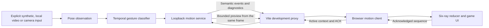

# Sway & Sprout architecture

Sway & Sprout is a local JavaScript/CSS app bundled by Vite. Manual play needs
only a browser. Optional motion input for **Catch the Sunshine** comes from an
explicitly started local service or the Android debug recorded-video diagnostic.
There are no accounts or cloud inference services.

## App flow and persistence

The screen flow is home → setup → play → confirmation/result → celebration or
garden. Players choose seated or standing instructions. Keyboard, touch and mouse
share the same actions; the Android host forwards remote keys to the JavaScript
handlers. Directional focus uses the relative centers of visible buttons.

Normal rounds last **30 seconds**, including manual play and ordinary
camera/video/synthetic sidecar input. `requestAnimationFrame` advances the active
round timer; pause and background handling stop progression. The countdown,
progress bar and round termination use the same duration.

The explicit `?input=video-verification` diagnostic uses **120 seconds** only
when the Sunshine motion-input option is selected. The Android debug video
factory adds this query when it creates a native replay source. This extends
the UI observation window, not the clip or gesture timing. Reaching six rays
still stops active input; the result appears at the round's timer boundary.
Other challenges and manual input retain 30 seconds. See the
[120-second rerun record](INDEPENDENT-NATURAL-EVALUATION-20261021.md).

Saved garden state is `{completed: string[], sessions: number}` in browser
`localStorage` under **`togethermove.v1`**. Normalization rejects unknown challenge
IDs and invalid counts. Storage failures are disclosed in the UI.

- Manual participation is self-reported through confirmation.
- A completed six-ray camera round can save Sunshine participation. An incomplete
  camera round offers a separately labelled manual confirmation.
- Explicit `video` and `synthetic` inputs exercise scoring but cannot save human
  participation. Provenance is retained through the confirmation/fallback path.
  Video completion displays a replay result and leaves the garden unchanged.

The [progress-preservation checks](MIGRATION-TEST-PLAN.md#required-post-copy-checks)
cover simulated completion and reload, including previously saved participation.

## Browser and sidecar data flow

The browser requests same-origin `/motion/events` and `/motion/preview`; the Vite
**development** server forwards only these routes to `127.0.0.1:8765`. The browser
does not open the camera. A built static bundle needs a separate route provider
for motion input; manual play has no such dependency.

The default Python backend verifies pinned OpenCV Zoo model and wrapper hashes,
checks unique DNN output shapes and runs startup forward passes. It detects and
estimates pose independently on each frame; it has no temporal ROI tracker.
Synthetic mode supplies deterministic landmarks to the same classifier rather
than establishing visual recognition accuracy. The separately pinned optional
Full IMAGE backend is file-only; its
[macOS launcher](../scripts/run-local-pose.py) denies external networking and
permits the loopback bridge. See its
[setup and limitations](MEDIAPIPE-FULL-VERIFICATION.md).

The temporal classifier requires a confident neutral pose before the expected
anatomical arm is held raised. Defaults are 300 ms neutral, 350 ms hold, 500 ms
cooldown and a maximum 300 ms frame gap. Pausing, lost visibility, wrong-side or
both-arm raises, and context changes break partial holds. These are prototype
rules, not population-validated movement measurements.

The browser validates bounded packets, runtime descriptors, source, stream,
client/round/revision, event age, sequence and alternating side before scoring.
A runtime marked `verified` proves its stated startup checks, not recognition
quality. Calibration diagnostics describe frame evidence and never create an
event. Old frames suppress readiness; polling cannot accumulate neutral time.

The service grants one local client a 1,500 ms active lease. Capture epochs reject
late inference from a previous context, and ACK reconciliation prevents
left/right drift across transport and pause boundaries. Only active event
polling can maintain capture. Preview reads cannot start it, renew the lease,
acknowledge an event or award a ray.

Camera frames stay in memory. The preview is a bounded, short-lived JPEG from the
same inference frame, sent over loopback to the browser. Pause, completion,
context loss or lease expiry clears it; the camera service does not record or
upload frames. Public-file diagnostic tools may separately write scalar results
for explicitly selected fixtures. See the
[sidecar protocol and privacy notes](../sidecar/README.md).

## Android host and diagnostic modes

The release host serves bundled web assets at the preserved
`https://app.togethermove.local` origin and blocks external navigation. It has no
ML runtime, video diagnostic source, camera permission or enabled motion proxy.
The product name is **Sway & Sprout**; compatibility identifiers remain
`com.togethermove.tv`, the debug `.motion` suffix, `togethermove.v1` and the
`togetherMoveKey` / `togetherMoveSuspend` JavaScript callbacks.

| Mode | Motion route | Execution boundary |
| --- | --- | --- |
| Release | Motion proxy disabled | Packaged manual-play app |
| Debug, without native replay | Fixed event-only proxy to `10.0.2.2:8765` | Android emulator's Mac-host alias; no physical Fire TV route or sidecar preview proxy |
| Debug, explicit native replay | Same-origin interception into an in-process source | Fixed bundled video/model selections; no Python fallback, camera or arbitrary file/network input |

The native replay worker owns indexed asset decoding, RGB letterboxing, CPU
LiteRT/MoveNet inference, crop state and ported gesture timing. It serves the
existing semantic protocol with `source: video` and an Android runtime/model
identity. Its preview contains metadata rather than pixel exports. File time
drives gesture dwell; wall time drives leases/event age and the UI round.
Pause/revision changes reject in-flight work, and Activity destruction closes the
decoder and interpreter.

Recorded Android emulator execution, build results and file replay outcomes are
documented separately from Mac/browser checks. They do not establish physical
Fire OS/UVC/Vega support, live-user recognition or sustained target-device
performance. See [native implementation and baseline evidence](NATIVE-VIDEO-VERIFICATION.md)
and the [later independent natural-video evaluation](INDEPENDENT-NATURAL-EVALUATION-20261021.md).

## Source map

| Responsibility | Files |
| --- | --- |
| Screens, input actions, timer, persistence and provenance | [`src/main.js`](../src/main.js) |
| Challenges, progress normalization and directional focus | [`src/model.js`](../src/model.js) |
| Packet validation, transport, runtime identity and scoring | [`src/motion.js`](../src/motion.js), [`src/runtime.js`](../src/runtime.js) |
| Calibration and bounded preview rendering | [`src/calibration.js`](../src/calibration.js), [`src/preview.js`](../src/preview.js), [`src/motion-view.js`](../src/motion-view.js) |
| Local input selection, default inference and temporal classifier | [`sidecar/run.py`](../sidecar/run.py), [`sidecar/inference.py`](../sidecar/inference.py), [`sidecar/motion.py`](../sidecar/motion.py) |
| Leases, capture epochs, ACK ledger and preview cache | [`sidecar/service.py`](../sidecar/service.py) |
| Development motion routes | [`vite.config.js`](../vite.config.js) |
| Android WebView host and remote input | [`MainActivity.java`](../android/app/src/main/java/com/togethermove/tv/MainActivity.java) |
| Debug native replay lifecycle and inference | [`NativeVideoReplay.java`](../android/app/src/debug/java/com/togethermove/tv/NativeVideoReplay.java), [`NativeMoveNet.java`](../android/app/src/debug/java/com/togethermove/tv/NativeMoveNet.java) |

The visual system uses forest, cream and lime with coral/gold/lavender moments,
large system type, visible focus and reduced-motion support. Artwork is local;
app content and controls remain HTML. Start with the
[README](../README.md) for setup and the [development handoff](DEVELOPMENT-HANDOFF.md)
for current acceptance work and dated evidence.
