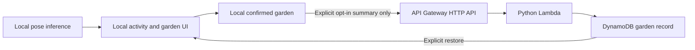

# Optional garden backup — local implementation, deployment pending

The proposed AWS component saves and restores the player's confirmed garden.
Vision stays local. The API accepts only the three completed-moment IDs and the
harvest counter, behind a random per-garden capability. It never accepts frames,
previews, landmarks, audio or inferred health/fitness data.

This is meant to serve an existing product action: keep a garden beyond a damaged
local progress record, then explicitly restore it. It is not a vision endpoint
or a claim that AWS makes movement recognition more accurate. The service and
web client are implemented for local testing. **No AWS resource has been created,
and no cloud runtime or competition compliance is claimed.**

## Product behavior

The web app shows Garden backup only when a valid HTTPS endpoint is explicitly
configured. The normal build has no endpoint, no backup control and no automatic
cloud request. Local play, growth, confirmation and harvest continue without it.
The backup screen explains the data being sent before the player chooses Save.
Restore is a separate explicit action. It merges completed blooms and keeps the
larger saved harvest counter; it does not create a current visit or an available
harvest. Deleting a remote backup requires its own confirmation.

Only confirmed saved progress is backed up. Counts, active rounds and temporary
synthetic/video results are excluded. Backups are not evidence that a person
moved: manual participation remains self-reported, and the API is not an
anti-cheating service.

The capability belongs to this browser and is stored separately from the garden.
Clearing all browser data also removes that key. There is no account, cross-device
transfer or lost-key recovery. A device that loses its capability cannot retrieve
the backup. No key appears in a URL or log.

## AWS design and boundaries

The intended region is `us-east-1`, subject to owner approval. The draft stack
uses an HTTP API, a 128 MiB Python 3.13 ARM64 Lambda and a Standard on-demand
DynamoDB table. It needs no model server, GPU, Bedrock call, NAT gateway, EC2,
COOL or continuous polling. The normal traffic is one small request when the
player saves, restores or deletes.

The API uses a random UUID and a 32-byte capability generated before the first
request. The server stores only its hash. Creates and updates use conditional
writes with an expected generation UUID and version. A new incarnation receives
a new generation, so an old request cannot overwrite or delete a recreated
record. Retrying an identical last write is idempotent; a conflicting generation
or version is rejected. Delete removes progress and leaves a progress-free
revocation tombstone for 30 days, blocking delayed creation retries during that
window. After the tombstone expires, suppression is not permanent; the client
retires deleted or authoritatively missing identities and uses a fresh key for
the next explicit backup. Offline errors and failed responses never
erase local progress. Leaving the backup screen cancels the client operation,
and a stale response cannot apply a restore to another screen.

The server enforces an exact JSON schema and a 2 KiB body limit. Retention is
30 days from the latest save; expired records are unavailable even before
DynamoDB's eventual TTL deletion. Origins are explicitly allowlisted. CORS is
not authentication; ownership is checked separately. No request bodies or
capabilities are deliberately logged.

The existing Android host blocks non-app origins, and its release manifest has
no Internet permission. That restriction remains. The new backup flow is disabled
at `app.togethermove.local`; it is a web feature in this implementation. A future
cloud-enabled native build would need a separately reviewed endpoint allowlist
and network configuration. The design keeps TV processing light, but **cloud
backup on a physical Fire TV has not been implemented or tested**.

## Cost proposal before any deployment

No spend is authorized. Proposed approval scope: **one 24-hour pilot, up to US$1
total**, followed by teardown. Continuing beyond that would require a separate
**US$5/month** budget approval. These are proposed spending limits, not existing
approval or a guaranteed billing cap.

For a small `us-east-1` demonstration, assume 10,000 HTTP requests in a month,
128 MiB Lambda execution averaging 500 ms, at most two small DynamoDB reads and
one write per request, and under 1 MiB of retained records. Ignoring free credits,
the request/compute/database line items should be only a few cents; allow under
US$1 for low-volume logs, storage and transfer. This is an estimate, not a quote
or measured bill. Recheck regional prices and the completed template before
approval. [API Gateway pricing](https://aws.amazon.com/api-gateway/pricing/),
[Lambda pricing](https://aws.amazon.com/lambda/pricing/),
[DynamoDB pricing](https://aws.amazon.com/dynamodb/pricing/).

The draft uses low API throttling, bounded Lambda concurrency/timeouts and
DynamoDB throughput limits. Anonymous conditional creation still exposes a
public route. Throttles are not hard spend caps; rejected requests may cost
money, and budget alerts can lag. Before a pilot, the owner must accept that
residual risk and approve a shutdown/teardown procedure. If a guaranteed hard
invoice ceiling is required, do not deploy this design on that assumption.

## Access and verification required later

Deployment needs explicit approval for the account/region, budget, endpoint
origins and retention, plus an existing authenticated deployment principal with
narrow rights to create/update/delete the named CloudFormation stack, HTTP API,
Lambda, table and log group. It must be allowed to create/pass the stack's
table-scoped Lambda execution role. No new credentials, role grant or account
change has been requested or performed by the implementation.

After that approval, verify stack creation, real Save/Restore/Delete, repeated
write behavior, ownership isolation, version conflicts, expiry, offline recovery
and teardown. Capture the deployed source/runtime/SDK versions and actual charges.
Local fake-storage tests do not establish those AWS outcomes. The competition's
running-AWS requirement remains open until a useful component actually runs.
