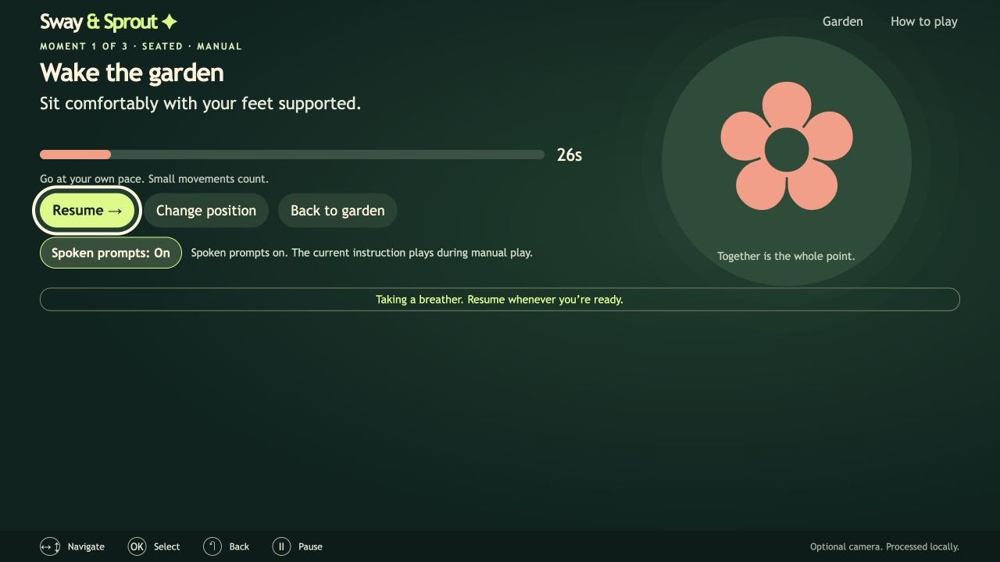
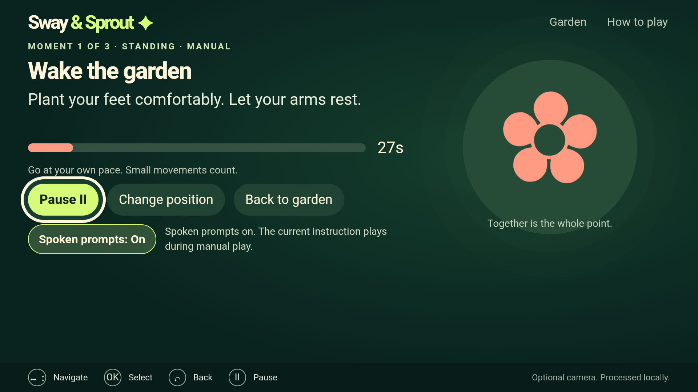

# Amazon Polly spoken activity prompts

Sway & Sprout incorporates **Amazon Polly** into its asset build pipeline.
Polly's `SynthesizeSpeech` API generates 18 real English MP3 clips from the exact
authored activity instructions in `src/model.js`: three moments, two positions,
three cue phases. The app's optional Spoken prompts feature plays those assets
during manual rounds, making instructions available without continuously reading
the TV. This is an application feature in addition to the submission video's
separate Polly narration.

## Use it

Run the ordinary app with `npm ci` and `npm run dev`. Select a moment, turn
**Spoken prompts: Off** to **On**, then Start. The current instruction speaks at
the start of the round and when the text changes at 10 and 20 seconds. Pause,
leaving play and changing position stop the clip. Resume restarts the current
instruction. Switching position pauses the round before the new position's cue.
Camera/synthetic/video play suppresses manual spoken cues.

Audio is off initially. The setting is held in memory and resets to Off when
the app restarts. It does not add fields to `togethermove.v1`. If a browser blocks
sound or an asset cannot load, visible feedback keeps manual play available.
Toggle Off and On to retry blocked playback.



[Listen to a generated seated prompt](../public/audio/prompts/wake-seated-0.mp3).

## Integration and privacy

`scripts/generate-spoken-prompts.mjs` invokes the official AWS CLI's
`polly synthesize-speech` operation using **Joanna**, **neural**, **en-US**,
**us-west-2**, **24,000 Hz MP3**. Only authored public prompt text is sent.
Credentials come from the developer's existing AWS credential provider; no
access key, account identifier or token is embedded in the application.

The Android asset host serves MP3 with `audio/mpeg` and no text encoding.
Its remote keys are proxied through JavaScript, so WebView playback is permitted
without a trusted DOM gesture; the app's explicit, default-off control gates
speech. External navigation and asset origins remain blocked.

The files in `public/audio/prompts/` ship with the Vite bundle and Android assets.
`src/spoken-prompts.js` plays relative local URLs. Playback needs no AWS account,
network connection or cloud call. Player data, camera frames and garden progress
are never sent to Polly. No Bedrock, AgentCore, Strands, SageMaker or Kiro use is
claimed. This is build-time speech synthesis with offline playback.

`public/audio/prompts/provenance.json` records every prompt's authored text,
service configuration, generation timestamp, byte length and SHA-256. All 18
clips were generated against the live service on October 23, 2026. Each clip is
2.256–4.248 seconds long and fits its ten-second cue window.

## Reproduce generation

The committed clips are ready to play, so ordinary setup never needs AWS access
or incurs a charge. To deliberately regenerate, install the official AWS CLI,
configure an authorized profile with `polly:SynthesizeSpeech`, and use an ignored
ledger directory. Review current [Polly pricing](https://aws.amazon.com/polly/pricing/)
first. The script conservatively reserves $16 per million input characters for
neural synthesis without assuming credits or a free tier.

Create a prior-usage JSON ledger with `requests` and `totalCostUpperBoundUsd`.
Use the example below only if there is no earlier spend to include:

```json
{"requests": [], "totalCostUpperBoundUsd": "0.000000"}
```

```sh
# Dry run: estimates only; no request or output writes.
node scripts/generate-spoken-prompts.mjs \
  --ledger artifacts/polly-prompts/usage.json \
  --prior-ledger artifacts/polly-prompts/prior-usage.json \
  --profile your-profile --max-new-usd 0.10 --max-total-usd 1

# Add --apply only after explicitly authorizing the estimate.
```

The script locks its usage ledger, reserves cost before each call, disables AWS
automatic retries, verifies cache hashes, and refuses to silently retry an
uncertain request. Keep the ledger and cached MP3s together. A mismatch requires
review instead of another billed request. Failed reservations count against the
cap. Changing authored text creates a new request identity. The aggregate cap
includes the supplied prior ledger; do not run another synthesis process that
uses a separate ledger at the same time.

The October 23 run retained one conservative $0.000656 reservation after local
AWS CLI parameter validation failed; explicit flags corrected the invocation.
The successful app prompts reserve $0.014512. Including the original demo's
$0.054720 narration/timing total, the conservative aggregate is **$0.069888** of
the authorized $1 ceiling. This is request-based accounting at the listed rate,
not a claim that an AWS invoice has been reconciled.

## Feedback

Polly produced short, consistent clips and allowed narration to remain offline
at play time. `describe-voices` confirmed Joanna Neural support. The CLI's custom
`synthesize-speech` command required explicit `--text`, `--voice-id` and
`--output-format`; generic `--cli-input-json` was rejected before output, so the
script uses explicit parameters and retains a regression test. The cached
developer login worked without changing credentials. The prior demo workflow
had required refreshing its expired session. Clearer documentation of custom
CLI argument behavior would reduce setup friction. I would use Polly again for
fixed, optional spoken guidance while keeping activity play offline.

## Evidence scope

The public demo's original native walkthrough predates this added audio feature.
Its emulator/progress evidence remains dated to that build. The audio feature has
separate October 23 unit/browser/asset verification and a fresh Android TV
Emulator runtime check: 21 checks pass using 15 real D-pad inputs. Actual MP3
decoding and advancing media time verify seated/standing playback, pause/resume,
position switching and Back. A nonempty saved garden remains byte-identical;
restart returns the audio setting to Off. Seven layout checkpoints at the actual
960×540 CSS viewport (1920×1080 pixels, DPR 2) have no clipped controls or scrolling.
All seven original AVD image hashes remain unchanged, and the disposable clone,
copied ADB identity and task ports were cleaned up. The earlier functional pass
that exposed clipping is retained alongside the fixed run.



See `docs/verification/aws-spoken-prompts-20261023.json` and the linked native
build/runtime reports. Physical Fire TV performance,
live-user recognition and an independent listening-quality rating remain
unverified. The standalone [Caption Pause Map](https://github.com/Xuefeng-Zhu/caption-pause-map)
project is additional open-source work; it edits caption timing metadata and
does not call AWS or edit audio.
